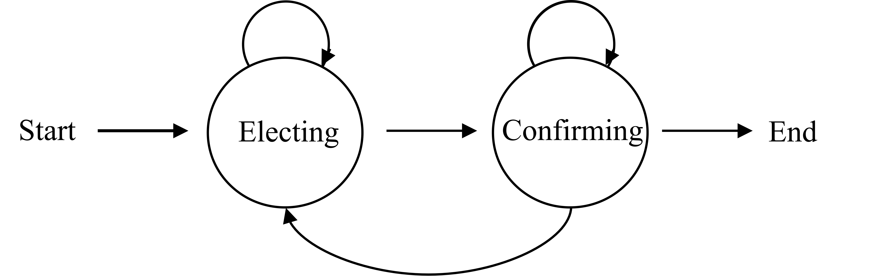

<div align="center">

# AdaPO: Towards Principled Efficient Rollout Allocation in Test-Time Training

**NeurIPS 2026**

Youkang Wang, Jian Wang, Tianyi Zeng, Xiaoyong Wei, Qing Li
<br>The Hong Kong Polytechnic University

</div>

Test-time training methods such as [TTRL](https://github.com/PRIME-RL/TTRL) build label-free rewards by majority voting over a **fixed, large** rollout budget for every query. Many queries reach consensus long before that budget is used up.

**AdaPO** replaces fixed-budget majority voting with an adaptive two-stage procedure built on a Bayesian sequential probability ratio test (SPRT):

<p align="center"></p>

* **Electing.** After a minimum of `N` rollouts, the leader `a_L` is triggered once its likelihood ratio against the runner-up `a_R`, `κ^(V(a_L) − V(a_R))`, reaches `A = (1−β)/α`.
* **Confirming.** The trigger is the first confirmation of the triggered candidate `c`. Each later rollout at which `c` still dominates every other answer (likelihood ratio ≥ `A`) adds one confirmation; if its likelihood ratio drops below `B = β/(1−α)`, the rule returns to Electing. Sampling stops once `c` has `Z*(γ)` confirmations, which bounds the posterior error of accepting it by `1−γ`. With the defaults `α = β = 0.05, γ = 0.95`, `γ/(1−γ) = A`, so `Z*(γ) = 1` and sampling stops at the first trigger; raise `γ` (e.g. `--gamma 0.995`) for extra confirmation rounds.
* **Update.** The pseudo-label from the stopping rule rewards the first `N` rollouts with `1[answer = pseudo-label]`, and those rollouts drive any policy-gradient algorithm (GRPO, PPO, REINFORCE++).

Here `κ = p₀(m−1)/(1−p₀)`. The success probability `p₀` is estimated **once**, from the first `N` rollouts, as `η` × (leader's vote share), and the number of candidates `m` as the number of distinct answers among them (at least 5). Both are then held fixed for the rest of the rollout process. If the first `N` (or more) rollouts all agree, sampling stops immediately.

AdaPO saves over 40% of rollout tokens on GPQA at competitive accuracy.

## Variants

| `variant=` | Rollout generation | Rollout budget charged |
|---|---|---|
| `sequential` (default) | **true early stopping.** Each rollout is a separate vLLM request; answers are consumed by the stopping rule strictly in rollout-index order, and the prompt's remaining requests are aborted as soon as the rule fires | rollouts consumed up to the stopping point |
| `batch_sequential` | rounds of `parallel_batch_size` rollouts per prompt; the rule processes a round once it has fully finished | every rollout of the executed rounds |
| `sequential_replay` | all `M` rollouts in one call, then replayed through the rule (the original simulation, no compute saving) | rollouts consumed up to the stopping point (simulated) |

All three use the same stopping rule (`verl/utils/reward_score/ttrl/adapo.py`) and, on the same sequence of answers, make exactly the same decision as drawing rollouts one at a time.

**How `sequential` stays fast.** Generating one rollout at a time would serialize up to `M` generations per prompt. Instead the scheduler (`verl/workers/rollout/vllm_rollout/adapo_rollout.py`):

1. launches the `N` mandatory rollouts of every prompt at once, since no decision is possible before `N`;
2. keeps `lookahead` further rollouts per prompt in flight beyond the consumption frontier, so the continuous-batching engine stays saturated across the prompts of the batch;
3. feeds each finished rollout to the rule once all lower-index rollouts are consumed;
4. aborts the prompt's in-flight requests the moment the rule fires.

Speculative rollouts never change the decision; they only cost extra tokens. `lookahead` trades wall-clock time against that waste. Both budgets are logged: `consumed` tokens (the paper's rollout budget) and `generated` tokens (everything actually decoded, including aborted partial rollouts).

Measured rollout-phase cost (Qwen2.5-Math-1.5B, one H20, M=64, N=32; same seeded rollouts for every policy; relative to generating all 64):

| Batch | Policy | Wall-clock | Tokens decoded |
|---|---|---|---|
| MATH, 32 prompts | `sequential`, lookahead 16 | 0.66 | 0.61 |
| MATH, 32 prompts | `batch_sequential`, B=32 | 0.67 | 0.66 |
| AMC, 8 prompts | `sequential`, lookahead 16 | 0.94 | 0.66 |
| AMC, 8 prompts | `batch_sequential`, B=32 | 0.96 | 0.74 |

With many prompts per GPU, generation is throughput-bound and token savings turn into wall-clock savings. With few prompts, wall-clock is bounded by the longest of the `N` mandatory rollouts, so it barely changes. Smaller `lookahead` (8) saves slightly more tokens; larger `lookahead` (32) can help small batches with long responses.

All variants run on any number of GPUs. The rollout always returns `M` rows per prompt, with flags for which rollouts were generated, so verl's data-parallel and tensor-parallel splitting works unchanged.

## Installation

```bash
git clone https://github.com/GeometricMLMechanism/AdaPO.git
cd AdaPO
conda create -n adapo python=3.10 -y && conda activate adapo
pip install torch==2.6.0 --index-url https://download.pytorch.org/whl/cu124
pip install flash-attn==2.7.4.post1 --no-build-isolation
pip install -r requirements.txt
pip install -e .
```

Optional: `wandb login` (or pass `--logger "['console']"`), and `huggingface-cli login` for the gated Llama models.

## Data

`data/` contains the four test-time training benchmarks (AIME 2024, AMC 2023, MATH-500, GPQA), plus MATH-500 split by difficulty level (`MATH-L{1..5}-TTT`, JSON only). `run_adapo.sh` converts the JSON files into the parquet files verl reads on first use. To convert them manually:

```bash
cd data && python preprocess.py --data_source AIME-TTT AMC-TTT MATH-TTT GPQA-TTT
```

## Running AdaPO

`run_adapo.sh` is the single entry point. It holds the model and task presets from the paper.

```bash
# Sequential variant, Qwen2.5-Math-1.5B on AMC 2023, GRPO
bash run_adapo.sh --model qwen2.5-math-1.5b --task AMC

# Batch-sequential variant, Llama-3.2-1B-Instruct on AIME 2024
bash run_adapo.sh --model llama3.2-1b --task AIME --variant batch_sequential --parallel-batch-size 16

# Multi-GPU (any variant)
bash run_adapo.sh --model llama3.1-8b --task AMC --variant batch_sequential

# PPO / REINFORCE++ instead of GRPO
bash run_adapo.sh --model qwen2.5-math-1.5b --task MATH --adv gae
bash run_adapo.sh --model qwen2.5-7b --task AIME --adv reinforce_plus_plus

# Ablations: degradation factor, confidence level, error rates, budgets
bash run_adapo.sh --model qwen2.5-math-1.5b --task AMC --eta 0.8 --gamma 0.99 --alpha 0.07 --beta 0.07
bash run_adapo.sh --model qwen2.5-math-1.5b --task AMC --min-rollouts 16 --max-rollouts 64

# Any other verl/Hydra option goes after `--`
bash run_adapo.sh --model qwen2.5-math-1.5b --task AMC -- trainer.test_freq=5
```

Run `bash run_adapo.sh --help` for every option.

| Model preset | HF model | GPUs (TP) |
|---|---|---|
| `qwen2.5-math-1.5b` | Qwen/Qwen2.5-Math-1.5B | 1 |
| `qwen2.5-7b` | Qwen/Qwen2.5-7B | 4 |
| `llama3.2-1b` | meta-llama/Llama-3.2-1B-Instruct | 1 |
| `llama3.1-8b` | meta-llama/Llama-3.1-8B-Instruct | 4 |

Defaults: `M=64` maximum rollouts, `N=32` minimum rollouts (also used for the update), `α=β=0.05`, `γ=0.95`, `η=0.6`, 3k-token responses, and nucleus sampling with temperature 0.6 / top-p 0.95 for training rollouts and for the 16 validation samples. Epochs: AIME 80, AMC 30, MATH 10, GPQA 15.

### AdaPO hyper-parameters

They live under `reward_model.reward_kwargs` in `verl/trainer/config/ppo_trainer.yaml`:

```yaml
reward_model:
  reward_kwargs:
    n_votes_per_prompt: 64        # M, maximum rollout budget
    n_samples_per_prompt: 32      # N, minimum rollout budget / rollouts used for the update
    variant: sequential           # sequential | batch_sequential | sequential_replay
    lookahead: 16                 # rollouts kept submitted beyond the next one the rule needs (sequential only)
    parallel_batch_size: 8        # B_par (batch_sequential only)
    adapo:
      alpha: 0.05
      beta: 0.05
      gamma: 0.95
      eta: 0.6                    # p_0 = eta * leader share of the first N rollouts (then frozen)
      min_num_candidates: 5       # lower bound on the number of candidate answers m
      m_mode: frozen              # m from the first N rollouts (frozen) or re-estimated every rollout (dynamic)
    log_dir: ${trainer.default_local_dir}/adapo_logs
```

## Outputs

Training metrics go to the configured logger (wandb by default):

* `ttrl/cumulative_tokens`, `ttrl/cumulative_completions`: rollout budget consumed so far
* `ttrl/cumulative_generated_tokens`: tokens actually decoded so far, including speculative and aborted rollouts
* `timing_s/gen`: wall-clock time of the rollout phase per step
* `train/adapo/samples_used`, `train/adapo/early_stopped`: rollouts consumed per prompt, and the fraction of prompts stopped before `M`
* `train/label_accuracy`: accuracy of the AdaPO pseudo-labels (uses ground truth, logging only)
* `train/extra/*`: `p₀`, `m`, `κ`, `Z*(γ)` (averaged over questions with `κ > 1`; it is undefined otherwise), confirmations collected, Electing↔Confirming transitions, and per-confirmation-round label accuracy
* `val/...`: mean@16 / pass@16 / pass@1 on the test set

Per-question traces (extracted answers, `Z*`, `p₀`, `κ`, rollouts used) and per-epoch summaries are written as JSON to `<trainer.default_local_dir>/adapo_logs/`.

## Code map

| File | Content |
|---|---|
| `verl/utils/reward_score/ttrl/adapo.py` | AdaPO stopping rule (Algorithm 1), pure Python |
| `verl/utils/reward_score/ttrl/ttt_metrics.py` | pseudo-label rewards, token accounting, metrics |
| `verl/workers/reward_manager/ttrl.py` | reward manager for both variants |
| `verl/workers/rollout/vllm_rollout/adapo_rollout.py` | early-stopping rollout scheduler (stream / rounds) |
| `verl/workers/rollout/vllm_rollout/vllm_rollout_spmd.py` | `generate_sequences_adapo`: runs the scheduler on the vLLM engine |
| `verl/trainer/ppo/ray_trainer.py` | training loop: pseudo-labelling and top-N selection before log-prob computation |
| `tests/` | unit tests for the stopping rule and the rollout scheduler (`python -m pytest tests/`) |

## Acknowledgements

This code builds on [TTRL](https://github.com/PRIME-RL/TTRL) and [verl](https://github.com/volcengine/verl); the benchmark files come from TTRL. Both projects are Apache-2.0 licensed, and so is this repository (see `LICENSE` and `Notice.txt`).

## Citation

```bibtex
@inproceedings{wang2026adapo,
  title     = {Towards Principled Efficient Rollout Allocation in Test-Time Training},
  author    = {Wang, Youkang and Wang, Jian and Zeng, Tianyi and Wei, Xiaoyong and Li, Qing},
  booktitle = {Advances in Neural Information Processing Systems},
  year      = {2026}
}
```
